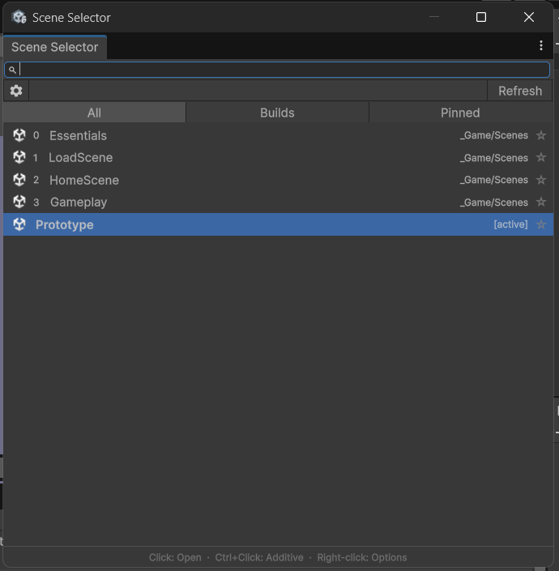
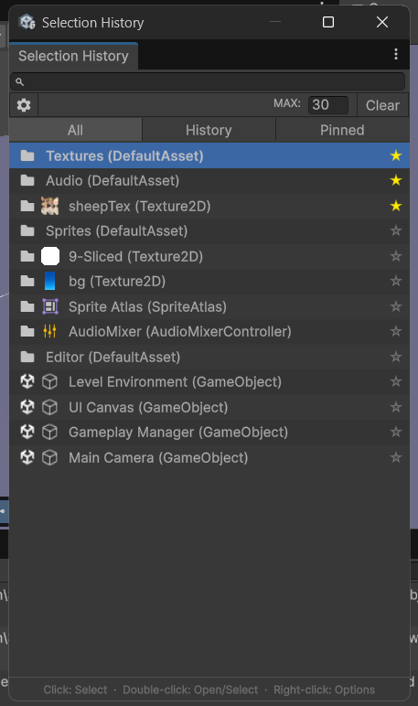
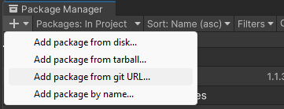

# Gustom [](https://github.com/vdgiapp/gustom/tree/upm) [](https://github.com/vdgiapp/Gustom/releases)
> 🛠️ A collection of reusable tools and utilities for Unity.


## Current Features
- Scene Selector
<p align="center">
  
</p>

- Selection History
<p align="center">
  
</p>

## Unity Version Support

- Unity 2022.3 or later

## How to Install into Your Unity Project

You can add the ArtificeToolkit to your Unity project as a package through Git. Follow these steps:
- Navigate to `Window -> Package Manager` in Unity.
- Click the **"+"** icon in the top-left corner of thePackage Manager.
- Select **"Add package from Git URL..."**.
<p align="center">
  
</p>

- In the popup that appears, paste the following URL:
```text
https://github.com/vdgiapp/gustom.git#upm
```
- *(Or use a specific version instead of `#upm` to lock the installation to a specified version).*
```text
https://github.com/vdgiapp/gustom.git#v1.0.0
```
